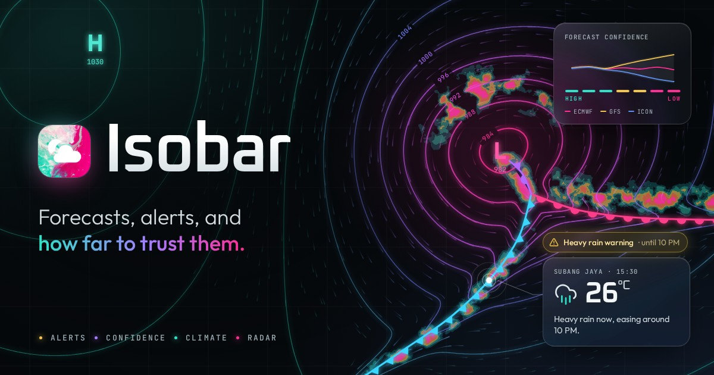
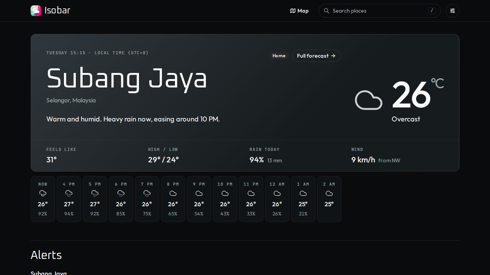

# Isobar

Weather that tells you what's happening, what's coming, and **how far to trust it**.

Isobar began as a Create React App bootcamp project (search a city, see the weather). It is now a
Next.js App Router application: a personal dashboard, severe-weather alerts from official feeds,
a three-model forecast-confidence check, 30-year climate comparison, a live radar map, and an
installable offline-capable PWA.



## What it does

| Feature                 | The question it answers                                                                                                                                                                                       |
| ----------------------- | ------------------------------------------------------------------------------------------------------------------------------------------------------------------------------------------------------------- |
| **Search** (`/` or ⌘K)  | "Where?": debounced autocomplete that aborts stale requests, recent searches, "use my location".                                                                                                              |
| **Place page**          | "What's it doing now, and today?": local time in _that city's_ timezone, a plain-language summary, 48-hour chart, 14-day outlook, conditions grid, air quality.                                               |
| **Alerts**              | "Is anything dangerous coming?": official warnings (MET Malaysia, US NWS) first, then clearly labelled signals derived from the forecast. States when a feed was unreachable instead of implying "all clear". |
| **Forecast confidence** | "Can I trust day 5?": compares ECMWF, GFS and ICON and rates each day high / medium / low, calling out when one model disagrees sharply.                                                                      |
| **Climate history**     | "Is this normal?": the last 12 months of daily highs and rainfall against 1991–2020 normals.                                                                                                                  |
| **Dashboard**           | "How are my places?": home forecast, saved places (up to 10, reorderable), alerts across all of them, and a week-ahead comparison for trip planning. No account: saved in a cookie.                           |
| **Radar map**           | "Is it about to rain on me?": two hours of live radar, your places on the map, click anywhere for the weather there.                                                                                          |
| **PWA**                 | "Does it work on a train?": installable; places you've opened keep working offline.                                                                                                                           |

## Quick start

Requires **Node ≥ 20.9** and **pnpm 11** (`corepack enable` picks the right version from `package.json`).

```bash
pnpm install
pnpm dev          # http://localhost:3000
```

No API keys or environment variables are needed: every data source is keyless.

### Scripts

| Script                                         | Does                                                                           |
| ---------------------------------------------- | ------------------------------------------------------------------------------ |
| `pnpm dev` / `pnpm build` / `pnpm start`       | Develop, production build, serve the build.                                    |
| `pnpm lint` / `pnpm typecheck` / `pnpm format` | ESLint, TypeScript (app **and** service worker), Prettier.                     |
| `pnpm test`                                    | Unit and component tests (Vitest).                                             |
| `pnpm test:e2e`                                | End-to-end tests (Playwright). **Build first**: `pnpm build && pnpm test:e2e`. |
| `node scripts/screenshots.mjs <url>`           | Regenerates the PWA install screenshots from a running build.                  |
| `node scripts/og-image.mjs`                    | Re-renders the link-preview image from `design/og-image.html`.                 |

`dev` and `build` also copy MapLibre's web worker into `public/` and (for `build`) bundle the
service worker into `public/sw.js`; both are generated and git-ignored.

## Configuration

Everything is optional; see [`.env.example`](.env.example).

| Variable             | Purpose                                                                                          |
| -------------------- | ------------------------------------------------------------------------------------------------ |
| `OPEN_METEO_API_KEY` | Switches to Open-Meteo's commercial hosts. Open-Meteo's free tier is for **non-commercial** use. |
| `NWS_USER_AGENT`     | Identifies your deployment to the US National Weather Service, which asks every client to.       |

## Deploying to Vercel

1. Import the repository in Vercel. The framework (Next.js) and package manager (pnpm, from the
   lockfile and the `packageManager` field) are detected automatically.
2. No environment variables are required. Deploy.
3. If Vercel's default pnpm differs from `pnpm@11.25.0` and the install step complains, add the
   environment variable `ENABLE_EXPERIMENTAL_COREPACK=1` so Vercel honours `packageManager`.

> **Not verified:** I could not deploy from the environment this was built in, so the Vercel
> steps above follow Vercel's documentation but have not been exercised. The production build
> (`pnpm build`) and the full test suite pass locally.

Afterwards, **revoke the OpenWeather key that was committed to the original repository**
(`5f472b7a…`, in the early commits of this repo's history). It is no longer used, but it is
public. The history was not rewritten.

## Testing

- **Unit and component tests** (213): the domain logic is deliberately pure and heavily tested:
  hazard thresholds, confidence rating, climate normals, unit conversion, timezone-correct
  formatting, preference parsing, official-feed matching, the search dialog's race handling. They use
  real API responses captured as fixtures (`src/test/fixtures`).
- **End-to-end tests** (38, Chromium): journeys, resilience, every feature, the map, offline PWA
  behaviour, and **axe-core accessibility checks on every page in light and dark**. Every upstream
  API is answered from fixtures by a small `fetch`-patching preload (`e2e/mock-upstream.mjs`), so
  the suite is deterministic, needs no network, and the production code contains no test hooks.
- **CI** (`.github/workflows/ci.yml`): format check, lint, typecheck, unit tests, then build and
  e2e.

Only Chromium is covered by the automated tests; Firefox and Safari have not been tested.

## Data sources and attribution

| Source                                                                                | Used for                                                                | Notes                                                                |
| ------------------------------------------------------------------------------------- | ----------------------------------------------------------------------- | -------------------------------------------------------------------- |
| [Open-Meteo](https://open-meteo.com/) (CC BY 4.0)                                     | Forecasts, three-model comparison, air quality, geocoding, ERA5 archive | Free for non-commercial use.                                         |
| [MET Malaysia](https://www.met.gov.my/) via [data.gov.my](https://data.gov.my/)       | Official warnings for Malaysia                                          | Matching is by place name; see limitations.                          |
| [US National Weather Service](https://www.weather.gov/documentation/services-web-api) | Official alerts for US places                                           |                                                                      |
| [RainViewer](https://www.rainviewer.com/)                                             | Radar tiles                                                             | Free tier: zoom ≤ 7 and a request rate limit; the app respects both. |
| [OpenFreeMap](https://openfreemap.org/)                                               | Basemap                                                                 | © OpenMapTiles, data © OpenStreetMap contributors.                   |

## Known limitations

- **Forecast-derived alerts are heuristics**, not official warnings. Their thresholds are
  documented in [`src/lib/alerts/hazards.ts`](src/lib/alerts/hazards.ts) and they are always
  labelled "forecast signal".
- **Official-warning matching is name-based.** MET Malaysia publishes free text listing states and
  districts; the matcher errs toward missing a district-level warning rather than raising a false
  one. The alert links to the issuer for the authoritative text.
- A `notFound()` or redirect that happens inside a streamed page returns HTTP 200 with a
  `noindex` tag rather than 404/308 (a characteristic of streaming; see
  [ARCHITECTURE](docs/ARCHITECTURE.md#decisions-and-trade-offs)).
- Saved places live in a cookie on one browser, so they don't sync across devices.
- `/api/places/search` has no rate limiting of its own; it relies on upstream caching.

## More

- [`docs/AUDIT.md`](docs/AUDIT.md): what was wrong with the original app and how each issue was resolved.
- [`docs/ARCHITECTURE.md`](docs/ARCHITECTURE.md): how it's built and why.

## Project layout

```
src/
  app/            routes: / (dashboard), /place/[key], /place/[key]/history, /map, /offline, API routes
  components/     ui (shadcn, re-themed) · place · dashboard · alerts · history · map · search · layout · pwa
  lib/            open-meteo (server-only fetchers) · alerts · weather (pure domain logic) · map · units, format, places, preferences
  sw/             the service worker and its routing rules
  test/           shared fixtures and setup
e2e/              Playwright specs and the upstream mock
scripts/          build-time helpers (service worker, MapLibre worker, screenshots)
```

## License

MIT. Originally created by Nur Imanina as a React bootcamp project.
